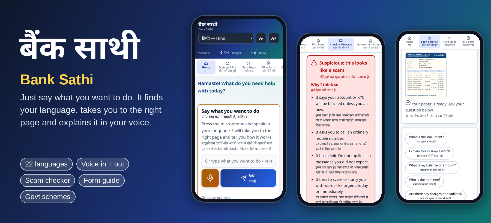
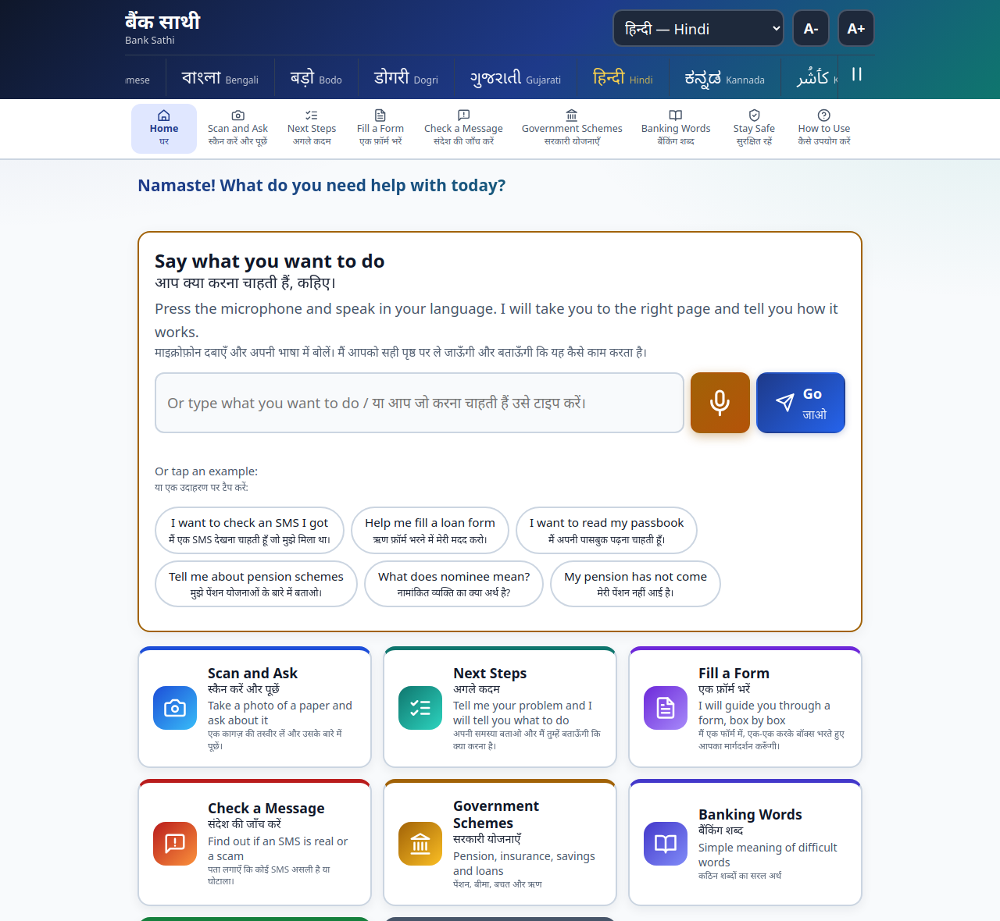
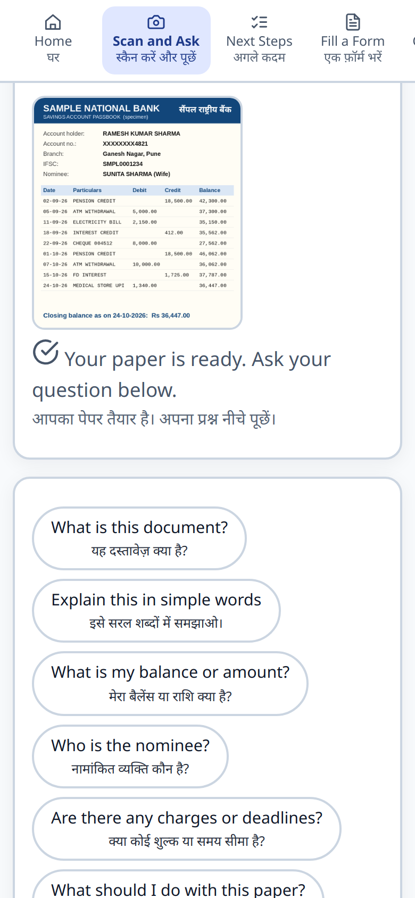
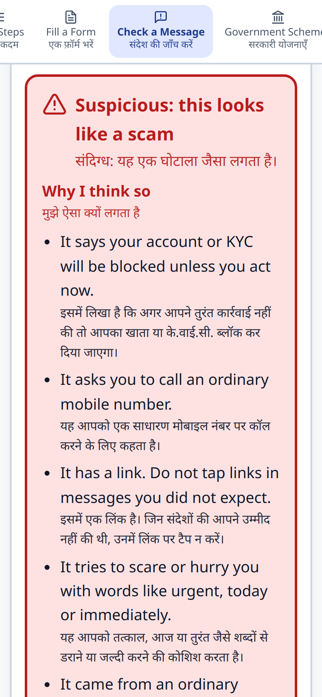
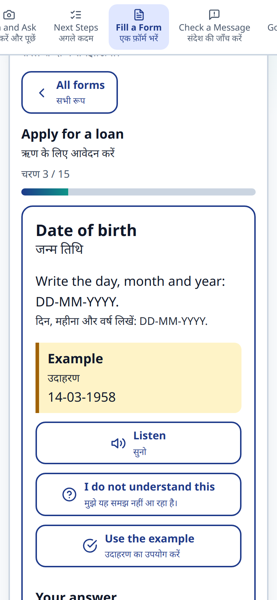

# बैंक साथी · Bank Sathi

### 🌐 Try it live: **<https://egg-easy-naturals-yeah.trycloudflare.com>**

💻 Code: <https://github.com/viren711/bank-sathi>

<sub>The live demo runs from a Cloudflare quick tunnel on the developer's machine, so the link changes if the tunnel restarts and it can be offline. To run your own copy, see [Setup and start the app](#setup-and-start-the-app).</sub>



## Just say what you want to do

Open the home page, press the big microphone and **say what you need in your own language**, for example *"मुझे लोन का फॉर्म भरना है"* ("I want to fill a loan form"), *"I want to check an SMS I got"* or *"என் பென்ஷன் வரவில்லை"*. There is no menu to find and no language to choose.

Bank Sathi **automatically detects the language you are speaking** (any of the 22 languages of the Indian Constitution, or English), switches the whole site to it, opens the right page and **plays a short spoken explanation** of what that page does and how to use it. If you type instead of speaking, the language is detected from your text too.

It is built for **elderly people and people who do not know English**. Show it a passbook, a form or an SMS, ask your question by typing or speaking, and get a simple answer in text **and** audio, with the English text always shown above the translation so a family member can follow along. It is a website, so it works on **any device, a phone, tablet or laptop**, with nothing to install: see [Use it on any device](#use-it-on-any-device).

Built on the [Sarvam AI](https://docs.sarvam.ai) APIs. Python (Flask) backend, plain HTML/CSS/JS front end, no build step.

## Screenshots

<p align="center">
  
  <br><sub><b>Home</b>: say or type what you want, tap an example, or pick a feature. The strip on top scrolls through all 22 languages.</sub>
</p>

<table>
  <tr>
    <td align="center" width="33%"><br><sub><b>Scan and Ask</b><br>Read a passbook and get the answer in your language</sub></td>
    <td align="center" width="33%"><br><sub><b>Check a Message</b><br>Real bank message or scam, with reasons and next steps</sub></td>
    <td align="center" width="33%"><br><sub><b>Fill a Form</b><br>One box at a time, explained in simple words</sub></td>
  </tr>
</table>

---

## What it does

| Page | What you can do |
|---|---|
| **Home** | A **voice prompt** ("Say what you want to do"): speak or type your goal in any language, Bank Sathi **detects the language and switches the whole site to it**, opens the right page and plays a short spoken explanation of how it works. Below it, nine large icon buttons for everything else. |
| **Scan and Ask** | Take a photo of (or upload) a passbook, FD, loan or pension paper, or tap a sample. Ask questions by typing or speaking. Answers appear in chat and are read aloud. |
| **Next Steps** | Describe a problem (type or speak), optionally add a photo, and get a step-by-step plan with the papers to carry. Keep chatting to refine it. |
| **Fill a Form** | A guided wizard for four forms (new account, loan, deposit slip, pension life certificate). One box at a time, with a plain explanation, an example, audio, and an "I do not understand" button. At the end you get a clean answer sheet to print. You can also upload any *other* form and chat about it. |
| **Check a Message** | Paste an SMS (and optionally the sender). Get a verdict: **suspicious**, **looks like a normal bank message**, or **not sure**, with the reasons and the next steps. Eleven sample messages included, such as fake KYC, lottery, fake deposit and genuine bank alerts. |
| **Government Schemes** | 15 schemes (PM Jan Dhan, Atal Pension, PM Suraksha Bima, Sukanya Samriddhi, SCSS, PPF, PM Kisan, Mudra, Ayushman Bharat and more). Filter by category, open a scheme for the facts, official website links, and ask your own questions about it. |
| **Banking Words** | Tap or type a word (nominee, KYC, EMI...) for a simple explanation with an example. |
| **Stay Safe** | Short fraud-prevention rules, readable aloud, with a link to report cyber fraud. |
| **How to Use** | A numbered guide to the whole website, readable aloud. |

Everywhere:

- **Automatic language detection** on the Home prompt: speak or type in any language and the whole site switches to it.
- **Revolving header** lists all 22 languages in their own script. Tap one to switch. Pause button included.
- **Bilingual UI**: English first, your language underneath.
- **Voice in and out**: microphone buttons (speech to text) and audio answers (text to speech) with Pause, Play and Stop. Audio stops when you change page.
- **Large text**: `A-` / `A+` buttons.
- **Light and dark mode**, works on phones, high contrast, big touch targets.

---

## Approach

**Problem.** Elderly people and people who do not read English struggle with bank papers, forms and SMS alerts, and are easy targets for fraud.

**Idea.** One simple website where a person shows a paper, asks in their own language by typing or speaking, and gets a short, simple answer as text and audio, then is guided to the next step.

**Design principles**

1. **Minimal and calm**: big buttons, big text, high contrast, one task per screen.
2. **Voice first**: every answer is read aloud and every text box has a microphone.
3. **Language first**: all 22 languages in the header; English always shown above the translation so a helper can follow.
4. **Safe by design**: for scam checks, clear rules decide the verdict and the AI only explains it. Documents stay in memory. The API key stays on the server.
5. **Honest about limits**: scheme and form answers use only written facts, link to official sites, and tell users to confirm at the bank.

**Voice navigation.** The Home prompt records speech, Sarvam Speech to Text transcribes it and detects the language, the site switches to that language, the chat model picks the best page from a fixed list (keyword rules are the fallback), and a short pre-written explanation of that page is translated and read aloud.

**Request flow.** The browser talks only to the Flask server. The server calls Sarvam, so the key is never exposed. Interface text is English in the code and is translated on demand, then cached on disk so every sentence is translated once per language. A photo is turned into text once and that text is sent to the chat model as context with each question. Answers are returned in the user's language and converted to speech.

A longer write-up is in [solutions.txt](solutions.txt).

---

## Tech stack

| Layer | Technology |
|---|---|
| AI | Sarvam AI: Chat (`sarvam-105b`), Translate (`sarvam-translate:v1`), Document Intelligence, Text to Speech (`bulbul:v3`), Speech to Text (`saaras:v4`), Language Identification, via the `sarvamai` Python SDK |
| Backend | Python 3.10+, Flask, python-dotenv |
| Frontend | Plain HTML, CSS and JavaScript (no framework, no build step), inline SVG icons |
| Browser features | `MediaRecorder` (microphone), `Audio` (playback), `fetch`, CSS variables, responsive grid |
| Security | API key in `.env` on the server, HTTPS with an auto-generated certificate, per-visitor rate limit |
| Sharing | Same Wi-Fi, or a Cloudflare quick tunnel for a public link |

---

## Sarvam APIs used

| Feature | API | Model |
|---|---|---|
| Answers, explanations, scam explanation | Chat Completions | `sarvam-105b` |
| Interface text in 22 languages | Translate | `sarvam-translate:v1` |
| Reading a photo/PDF of a document | Document Intelligence (Sarvam Vision) | async job, markdown output |
| Reading answers aloud | Text to Speech | `bulbul:v3` |
| Microphone input, and detecting the spoken language | Speech to Text | `saaras:v4` (`language_code="unknown"` auto-detects) |
| Detecting the language of typed text | Language Identification | `/text-lid` |

**Voices:** Sarvam text to speech covers 11 of the 22 languages plus English (Bengali, Gujarati, Hindi, Kannada, Malayalam, Marathi, Odia, Punjabi, Tamil, Telugu). The other languages (Assamese, Bodo, Dogri, Kashmiri, Konkani, Maithili, Manipuri, Nepali, Sanskrit, Santali, Sindhi, Urdu) are read with the Hindi voice. Text answers are still in the chosen language.

See [api.txt](api.txt) for a summary of every Sarvam API.

---

## Setup and start the app

**You need:** Python 3.10 or newer, and a Sarvam API key from the [Sarvam dashboard](https://indus.sarvam.ai/key-management) (new verified accounts get free credits). `openssl` must be installed for the HTTPS certificate (it is on Linux and macOS by default; on Windows it comes with Git for Windows).

**1. Get the code**

```bash
git clone https://github.com/viren711/bank-sathi.git
cd bank-sathi
```

**2. Create a virtual environment and install**

```bash
python3 -m venv .venv
source .venv/bin/activate            # Windows (PowerShell): .venv\Scripts\Activate.ps1
pip install -r requirements.txt
```

**3. Add your API key**

```bash
cp .env.example .env                 # Windows: copy .env.example .env
```

Open `.env` and replace the placeholder:

```
SARVAM_API_KEY=your_sarvam_api_key_here
```

**4. Start the app**

```bash
PORT=5057 python app.py              # Windows (PowerShell): $env:PORT=5057; python app.py
```

**5. Open it**

- On the same computer: **https://localhost:5057**
- On a phone or another computer on the same Wi-Fi: **https://YOUR-COMPUTER-IP:5057** (see [Use it on any device](#use-it-on-any-device))

The first time, the browser warns about the certificate because it is self-signed (see [HTTPS and the microphone](#https-and-the-microphone)). Click *Advanced → Proceed*. Stop the app with `Ctrl+C`.

> If `python3 -m venv` fails on Debian/Ubuntu, run `sudo apt install python3-venv`, or create the venv with `python3 -m venv --without-pip .venv` and install with `pip --python .venv/bin/python install -r requirements.txt`.

### Settings (environment variables)

| Variable | Default | Meaning |
|---|---|---|
| `SARVAM_API_KEY` | none (required) | Your Sarvam key, read from `.env`. Never commit it. |
| `PORT` | `5000` | Port to listen on. |
| `HTTPS` | `1` | `0` serves plain http (the in-page microphone then only works on `localhost`). |
| `RELOAD` | `1` | `0` turns off auto-restart when you edit a `.py` file. |
| `RATE_LIMIT` | `60` | API calls per visitor per minute. Protects your credits when the site is public. |

---

## Use it on any device

Bank Sathi is a normal website, so it runs on **any phone, tablet or laptop** with a modern browser (Chrome, Safari, Edge, Firefox) and needs no app install. The layout switches between a single column on phones and a wider grid on laptops.

**Same Wi-Fi (phone, tablet or another laptop):**

1. Start the app (it listens on all network interfaces).
2. Find your computer's IP: `hostname -I` (Linux), `ipconfig getifaddr en0` (macOS), `ipconfig` (Windows).
3. On the phone open `https://<that-ip>:5057`, accept the certificate warning once, and allow the microphone when asked.
4. If it does not load, open the port in your firewall, for example `sudo ufw allow 5057/tcp`.

### HTTPS and the microphone

Browsers only allow in-page recording on **secure** pages. On a LAN address over plain `http://` the microphone button cannot record, so Bank Sathi serves **HTTPS with a self-signed certificate** that it creates automatically in `certs/` (valid for `localhost` and your current LAN IPs). If your IP changes, delete the `certs/` folder and restart to get a new one.

---

## Share it publicly (Cloudflare Tunnel)

A free "quick tunnel" gives you a public `https://....trycloudflare.com` link to the app running on your machine. No account needed.

```bash
# 1. start the app
PORT=5057 python app.py

# 2. in a second terminal
cloudflared tunnel --url https://localhost:5057 --no-tls-verify
```

`cloudflared` prints the public link. Because it forwards to your running app:

- edits to files in `static/` show up on the next page reload;
- edits to `app.py` restart the server by themselves (auto-reload);
- the link stays the same **as long as the tunnel keeps running**. A new `cloudflared` run gives a new link. For a permanent address use a named tunnel with your own domain.

**Be careful:** anyone with the link uses *your* Sarvam credits. The built-in rate limit (`RATE_LIMIT`, per visitor) helps, but stop the tunnel when you are not demoing. ngrok works the same way: `ngrok http https://localhost:5057`.

Install cloudflared: <https://developers.cloudflare.com/cloudflare-one/connections/connect-networks/downloads/>

---

## Add your own content

### More sample documents

Drop any `.png`, `.jpg`, `.jpeg` or `.webp` into `static/samples/` and reload. It appears on the Scan and Fill a Form pages automatically; the label comes from the file name (`my_pension_book.png` becomes "My Pension Book"). To regenerate the built-in specimens: `python tools/make_samples.py`.

### More schemes, forms, messages, tips

Everything shown to users is plain data in [`static/data.js`](static/data.js):

- `SCHEMES` and `SCHEME_LINKS`: add an object with `id`, `tag`, `name`, `short`, `who`, `benefit`, `how`, `docs`, and its official links.
- `FORMS`: add a form with `fields: [label, help, example]`.
- `SMS_SAMPLES`, `TIPS`, `WORDS`, `HOW_TO`.

Write it in **English**. The server translates it on demand into the chosen language and saves the result in `translation_cache.json`, so each string is translated once per language for all users.

> Scheme details were written from general knowledge, not copied from official pages. Rates, limits and rules change, so verify before relying on them. Each scheme links to its official site.

---

## How it works

```
Browser (static/)                      Flask (app.py)                      Sarvam
┌──────────────────────┐   fetch      ┌──────────────────────┐
│ index.html           │ ───────────► │ /api/translate       │ ─────────► Translate
│ style.css            │              │ /api/upload          │ ─────────► Document Intelligence
│ app.js  (UI + voice) │ ◄─────────── │ /api/chat            │ ─────────► Chat (sarvam-105b)
│ data.js (content)    │   JSON       │ /api/check-sms       │ ─────────► Chat
└──────────────────────┘              │ /api/tts, /api/stt   │ ─────────► Text to Speech / Speech to Text
                                      └──────────────────────┘
```

- **Your API key stays on the server.** The browser never sees it.
- **Documents** are read once into text and kept **in memory only** (lost on restart, never written to disk). The chat sends that text as context with each question.
- **Translations** are lazy: each page translates only the strings it shows, in parallel, with retry on rate limits, then caches them.
- **Message checker**: transparent rules (links, urgency, requests for OTP/PIN, prizes, KYC threats, ordinary-number senders, easy-loan offers) decide the verdict. The AI only explains it in your language and gives next steps, so it cannot talk itself into calling a scam "safe". If the AI call fails, the verdict and standard steps still show.
- **Scheme and form answers** are given only the facts in `data.js` and told not to invent numbers.

### API endpoints

| Method and path | Purpose |
|---|---|
| `GET /api/languages` | The 22 languages (code, English name, native name). |
| `GET /api/samples` | Images in `static/samples/`. |
| `POST /api/detect-lang` | `{text}` → `{lang}`: language of typed text (Sarvam language identification). |
| `POST /api/route` | `{text, lang}` → `{tab}`: which page a spoken or typed request belongs to (AI with keyword fallback). |
| `POST /api/translate` | `{lang, strings[]}` → translated strings (cached). |
| `POST /api/upload` | Multipart `file` (jpg, png, pdf, max 10 MB) + `lang` → `{doc_id}`. |
| `POST /api/chat` | `{question, lang, doc_id?, history?, context?}` → `{answer}`. |
| `POST /api/check-sms` | `{text, sender?, lang}` → `{verdict, flags[], answer}`. |
| `POST /api/tts` | `{text, lang}` → base64 WAV audio. |
| `POST /api/stt` | Multipart audio `file` + `lang` → `{text}`. |

### Project structure

```
app.py                 Flask server, all API routes, rate limit, HTTPS setup
static/
  index.html           page skeleton and icons
  style.css            theme (light/dark), responsive layout
  app.js               navigation, translation, voice, chat, wizards
  data.js              schemes, forms, tips, sample messages
  samples/             sample documents (add your own here)
tools/make_samples.py  regenerates the specimen documents
main.py                the smallest possible Sarvam chat call
api.txt                notes on every Sarvam API
requirements.txt       Python dependencies
.env.example           copy to .env and add your key
```

---

## Troubleshooting

| Problem | Fix |
|---|---|
| `402 insufficient_quota_error` / "no credits" | Your Sarvam account is out of credits. Top up on the dashboard. |
| `429` / "too many requests" | Sarvam's per-minute limit (60 on pay-as-you-go) or the built-in `RATE_LIMIT`. Wait a minute. |
| `403` | The API key is wrong or missing. Check `.env`. |
| Microphone opens a file picker | The page is not on HTTPS or `localhost`. Use `https://` and accept the certificate. |
| Phone cannot reach the site | Same Wi-Fi? Use `https://`, check the firewall (`sudo ufw allow 5057/tcp`). |
| First visit in a new language is slow | The first translation is fetched from Sarvam, then cached. |
| Port already in use | Pick another: `PORT=5058 python app.py`. |
| Photo says "no text found" | Retake it flat, well lit and in focus. |

---

## Publish to GitHub

```bash
git init
git add .
git status                      # check that .env and certs/ are NOT listed
git commit -m "Bank Sathi: multilingual banking helper"
gh repo create bank-sathi --public --source=. --remote=origin --push
```

Without the GitHub CLI: create an empty public repo on github.com, then

```bash
git branch -M main
git remote add origin https://github.com/viren711/bank-sathi.git
git push -u origin main
```

`.env` (your key) and `certs/` are in `.gitignore`. If you ever commit a key by mistake, **revoke it on the Sarvam dashboard** and create a new one; deleting the commit is not enough.

---

## Credits

Built with [Sarvam AI](https://www.sarvam.ai). Icons are Lucide-style stroke icons. All names, numbers and banks in the sample documents are made up.
